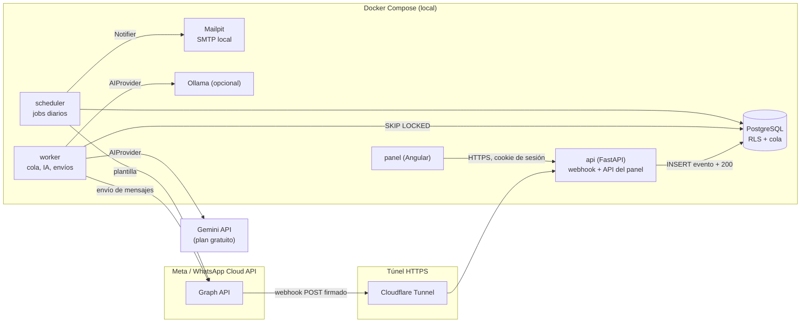
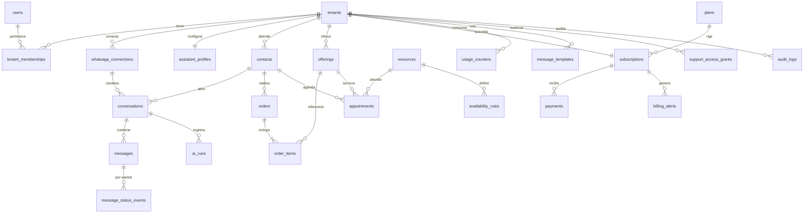
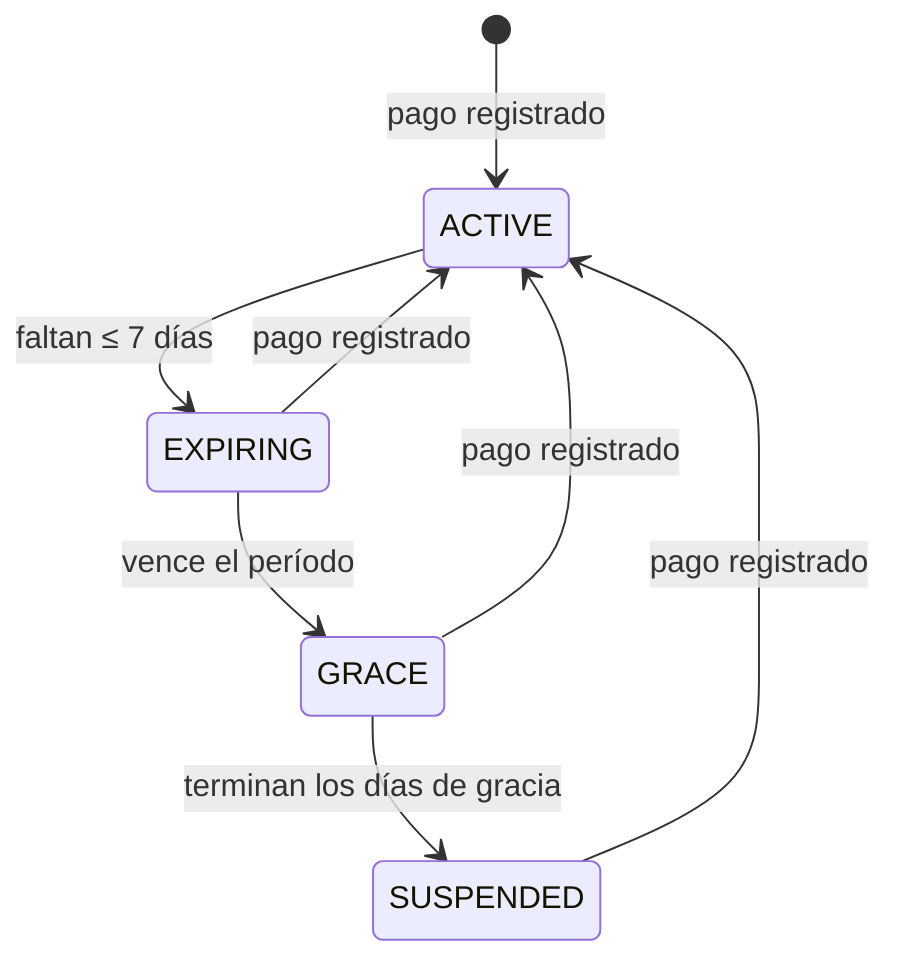

# Arquitectura — Plataforma multi-tenant de tiendas con asistente de IA en WhatsApp

Estado: **aprobada** (2026-11-06) · Fase en curso: ver §13

## 1. Objetivo

Plataforma SaaS multi-tenant de tiendas virtuales con asistente de IA en WhatsApp. Cada negocio
se agrega por configuración, sin crear una aplicación nueva. Permite vender productos, ofrecer
servicios, agendar citas y cobrar una suscripción a cada negocio.

## 2. Fase actual: demo de costo cero

| Componente | Decisión para la demo |
|---|---|
| WhatsApp | Número de prueba de Cloud API de Meta (hasta 5 destinatarios verificados) |
| Base de datos | PostgreSQL local en Docker |
| IA | Proveedor intercambiable: Gemini (plan gratuito, solo datos ficticios) u Ollama local |
| Webhook | Túnel HTTPS gratuito (Cloudflare Tunnel) |
| Backend | Python + FastAPI (API, worker y scheduler en la misma imagen) |
| Panel | Angular |
| Orquestación | Docker Compose |
| Correo | Mailpit en Docker (servidor SMTP local que captura correos, sin envío real) |

Alcance funcional: catálogo, citas, conversación con IA, traspaso a humano, bitácora, gestión de
suscripción y alertas de vencimiento.

Limitaciones conocidas:

- El número de prueba no sirve para clientes reales ni para validar Coexistence.
- Solo existe un número de prueba: la segunda tienda se simula por configuración (ver §11, punto 1).

### 2.1 Decisiones aprobadas (2026-11-06)

| Decisión | Detalle |
|---|---|
| Conexión simulada | Se acepta `connection_type = SIMULATED`, habilitado solo con `APP_ENV=demo`, para la segunda tienda (§11, punto 1) |
| Cupo del plan | Se mide por **ambas** métricas: conversaciones atendidas por IA y tokens de IA. Cada plan define los dos límites; las alertas del 80 % y 100 % se emiten por la métrica que llegue primero |
| Ejecución de la demo | Todo corre en Docker en la máquina del dueño del proyecto (no en la nube) |

## 3. Decisiones de negocio

- Cada tienda usa su propio número de WhatsApp.
- El dueño conserva la propiedad de su cuenta de WhatsApp Business y de su número.
- Diseño final: una sola app de Meta y un solo webhook, con WABA, `phone_number_id` y token por
  tienda.
- Vía principal futura: Embedded Signup como Tech Provider.
- Vía temporal de piloto: conexión manual.
- Ambas detrás de la interfaz `WhatsAppConnection`, con `connection_type` `EMBEDDED_SIGNUP` o
  `MANUAL`. En la demo se añade `SIMULATED` (§2.1).
- Coexistence requiere Embedded Signup y la app WhatsApp Business; no funciona pegando un token.
- El asistente se limita a ventas, soporte y citas de cada negocio. Nunca funciona como IA de
  propósito general (las políticas de WhatsApp Business lo prohíben cuando la IA es la función
  principal del servicio).

## 4. Arquitectura lógica

### 4.1 Componentes



### 4.2 Capas del backend

Cada módulo sigue la misma estructura simple:

- `router.py`: endpoints HTTP y esquemas de entrada y salida (Pydantic).
- `service.py`: casos de uso; sin dependencias de FastAPI.
- `repository.py`: acceso a datos con SQLAlchemy (consultas parametrizadas).
- `ports.py` / `adapters/`: solo donde hay proveedores intercambiables (IA, WhatsApp, correo, reloj).

Se evita una arquitectura hexagonal completa en todos los módulos (KISS); los puertos se usan
donde aportan sustitución real o pruebas aisladas.

### 4.3 Cola de trabajo

La cola es la propia tabla `webhook_events` en PostgreSQL, consumida con
`SELECT … FOR UPDATE SKIP LOCKED`. Ventajas frente a Redis/Celery en esta fase:

- Una pieza menos de infraestructura.
- La deduplicación y el encolado ocurren en la misma transacción.
- Reintentos con `attempts` y `next_attempt_at`; estado `DEAD` tras el máximo de intentos.

Los mensajes salientes usan `messages` con estado `PENDING` como *outbox*.

## 5. Flujo de mensajes

### 5.1 Entrante y respuesta de la IA

```mermaid
sequenceDiagram
    autonumber
    participant M as Meta
    participant A as api (webhook)
    participant DB as PostgreSQL
    participant W as worker
    participant IA as AIProvider
    participant T as Herramientas

    M->>A: POST /webhooks/whatsapp (X-Hub-Signature-256)
    A->>A: HMAC-SHA256 del cuerpo crudo con App Secret (comparación en tiempo constante)
    alt firma inválida
        A-->>M: 401 (sin persistir contenido)
    else firma válida
        A->>DB: INSERT webhook_events por ítem ON CONFLICT (dedup_key) DO NOTHING
        A-->>M: 200
    end
    W->>DB: toma evento (SKIP LOCKED)
    W->>DB: resuelve tenant por phone_number_id
    W->>DB: SET LOCAL app.tenant_id
    W->>DB: INSERT messages (wamid UNIQUE) y actualiza last_customer_message_at
    W->>W: espera breve de agrupación (ráfagas del cliente)
    W->>DB: lee conversación
    alt mode = HUMAN o paused_until > now() o suscripción SUSPENDED
        W->>DB: solo guarda; no llama a la IA
    else mode = AI
        W->>IA: historial acotado + herramientas permitidas
        IA->>T: llamadas a herramientas (contexto inyectado por el servidor)
        T->>DB: consultas con RLS
        IA-->>W: respuesta final
        W->>DB: INSERT ai_runs
        W->>DB: SELECT conversación FOR UPDATE (revalidación)
        alt sigue en AI y sin pausa
            W->>DB: INSERT messages (OUT, AI, PENDING)
            W->>M: POST /messages
            M-->>W: wamid
            W->>DB: UPDATE messages SET wamid, status = SENT
        else una persona intervino
            W->>DB: descarta la respuesta (queda en ai_runs con outcome SUPERSEDED)
        end
    end
```

### 5.2 Reglas del flujo

1. El webhook valida `X-Hub-Signature-256`, guarda el evento, lo encola y responde 200 de
   inmediato.
2. Deduplicación con `UNIQUE` sobre `wamid` (mensajes) y `(wamid, status)` (estados).
3. El worker consulta el estado de la conversación. En modo `HUMAN` guarda el mensaje y no llama
   a la IA.
4. La IA recibe solo el historial necesario (ventana de N mensajes) y usa herramientas
   controladas.
5. Antes de enviar se revalida el estado con bloqueo de fila (`FOR UPDATE`), porque una persona
   pudo intervenir.
6. La salida se guarda como `PENDING`, se llama a la API y se registra el `wamid`.
7. `sent`, `delivered`, `read` y `failed` se registran sin asumir orden de llegada. El estado
   visible del mensaje solo avanza según un rango (`PENDING < SENT < DELIVERED < READ`);
   `FAILED` es terminal. Un estado que llega antes de conocer el `wamid` queda en
   `message_status_events` y se reconcilia después.
8. Al recibir `smb_message_echoes` (mensaje enviado por el dueño desde la app WhatsApp Business
   en Coexistence) se fija `paused_until = now() + intervalo configurable`.
9. Fuera de la ventana de 24 horas desde `last_customer_message_at` solo se envían plantillas.
10. Se responde preferentemente en un solo mensaje, no en varias burbujas.
11. Un solo worker procesa a la vez cada conversación (`pg_advisory_xact_lock` por
    `conversation_id`), para no generar dos respuestas a una ráfaga de mensajes.

### 5.3 Precedencia de control de la conversación

| Condición | La IA responde |
|---|---|
| Suscripción `SUSPENDED` | No |
| Cupo del plan al 100 % | No (se ofrece traspaso a humano) |
| `mode = HUMAN` | No |
| `paused_until > now()` | No |
| Fuera de ventana de 24 h | No (solo plantillas) |
| Ninguna de las anteriores | Sí |

## 6. Asistente de IA

### 6.1 Puerto `AIProvider`

```text
AIProvider.generate(request: ChatRequest) -> ChatResult
  ChatRequest: system_prompt, messages, tools (esquemas JSON), max_output_tokens
  ChatResult:  text | tool_calls, input_tokens, output_tokens, model, latency_ms
```

Adaptadores: `GeminiProvider`, `OllamaProvider` y `ScriptedProvider` (determinista, para pruebas).

### 6.2 Herramientas

Todas reciben un `ToolContext(tenant_id, contact_id, conversation_id)` construido por el servidor.
Sus argumentos se validan con Pydantic; un argumento inválido devuelve error al modelo una vez y,
si se repite, se ofrece traspaso a humano.

| Herramienta | Módulo requerido | Tipo |
|---|---|---|
| `search_offerings(query, kind)` | CATALOG | Lectura |
| `get_offering(offering_id)` | CATALOG | Lectura |
| `check_availability(service_id, date)` | APPOINTMENTS | Lectura |
| `propose_order(items)` | ORDERS | Escritura en borrador |
| `confirm_order(order_id)` | ORDERS | Escritura, exige confirmación explícita del cliente |
| `book_appointment(service_id, starts_at)` | APPOINTMENTS | Escritura, exige confirmación explícita |
| `cancel_appointment(appointment_id)` | APPOINTMENTS | Escritura, solo citas del propio contacto |
| `get_my_orders()` / `get_my_appointments()` | ORDERS / APPOINTMENTS | Lectura, solo del contacto |
| `request_human()` | Siempre | Cambia `mode` a `HUMAN` |

### 6.3 Defensa contra prompt injection

- El prompt de sistema fija el ámbito (negocio, temas permitidos) y es versionado
  (`prompt_version` en `ai_runs`).
- El texto del cliente se entrega como contenido de usuario, nunca concatenado en el prompt de
  sistema.
- Las herramientas no aceptan identificadores de tenant ni de contacto; ignoran cualquier intento
  del modelo de cambiar el ámbito.
- Las acciones de escritura requieren un paso de confirmación verificable en el historial.
- Validación de salida: longitud máxima, sin URLs fuera de la lista blanca de la tienda, sin
  precios que no provengan de una herramienta en el mismo turno.
- Clasificador ligero de fuera de ámbito (reglas + instrucción) que responde con un mensaje fijo.

## 7. Modelo de datos

### 7.1 Convenciones

- PK `uuid` (v7 generado en la aplicación, ordenable por tiempo).
- `created_at timestamptz NOT NULL DEFAULT now()`; zona horaria de negocio en `tenants.timezone`.
- Montos en `numeric(12,2)` con `currency char(3)`.
- Enumeraciones como `text` con `CHECK`, para migraciones simples.
- Tablas de negocio: `tenant_id NOT NULL`, RLS + `FORCE ROW LEVEL SECURITY`, FKs compuestas.

### 7.2 Diagrama entidad-relación



### 7.3 Tablas

**Plataforma (sin RLS por tenant; acceso restringido por rol de base de datos)**

| Tabla | Columnas clave | Restricciones |
|---|---|---|
| `tenants` | `id, slug, name, status, timezone, currency, enabled_modules text[]` | `slug` UNIQUE; módulos ⊆ {CATALOG, ORDERS, APPOINTMENTS} |
| `users` | `id, email citext, password_hash, is_platform_admin, status, last_login_at` | `email` UNIQUE |
| `tenant_memberships` | `tenant_id, user_id, role` | UNIQUE `(tenant_id, user_id)`; `role` ∈ {OWNER, STORE_ADMIN, AGENT} |
| `plans` | `id, code, name, price_monthly, currency, ai_conversation_limit, ai_token_limit, allowed_modules, active` | Ambos límites > 0 (§2.1) |
| `webhook_events` | `id, tenant_id NULL, phone_number_id, event_kind, dedup_key, payload jsonb, status, attempts, next_attempt_at, locked_at, last_error_code, received_at` | `dedup_key` UNIQUE; es la cola |
| `job_runs` | `job_name, run_date, status, started_at, finished_at` | UNIQUE `(job_name, run_date)` |

**Negocio (con `tenant_id` y RLS)**

| Tabla | Columnas clave | Restricciones |
|---|---|---|
| `whatsapp_connections` | `id, tenant_id, connection_type (EMBEDDED_SIGNUP, MANUAL, SIMULATED), waba_id, phone_number_id, display_phone_number, token_ciphertext, token_nonce, key_id, status, is_coexistence, token_rotated_at` | `phone_number_id` UNIQUE global; una conexión `ACTIVE` por tenant |
| `assistant_profiles` | `tenant_id, business_summary, tone, allowed_topics, handoff_rules, provider, model, prompt_version, echo_pause_minutes` | Una por tenant |
| `contacts` | `id, tenant_id, wa_id, wa_id_hash, profile_name, opted_in_at` | UNIQUE `(tenant_id, wa_id)` |
| `conversations` | `id, tenant_id, contact_id, connection_id, mode, assigned_agent_id, paused_until, last_customer_message_at, status, version` | `mode` ∈ {AI, HUMAN}; una abierta por contacto |
| `messages` | `id, tenant_id, conversation_id, direction, origin, wamid, message_type, body, payload, status, status_rank, error_code, ai_run_id, sent_by_user_id` | `wamid` UNIQUE (parcial, no nulo); `origin` ∈ {CUSTOMER, AI, HUMAN, TEMPLATE} |
| `message_status_events` | `id, tenant_id, wamid, status, occurred_at, pricing jsonb, error_code` | UNIQUE `(wamid, status)`; solo inserción |
| `ai_runs` | `id, tenant_id, conversation_id, trigger_message_id, provider, model, prompt_version, tools_used jsonb, input_tokens, output_tokens, latency_ms, outcome, error_code` | Solo inserción; sin contenido de mensajes |
| `offerings` | `id, tenant_id, kind, sku, name, description, price, currency, track_stock, stock, duration_minutes, active` | `kind` ∈ {PRODUCT, SERVICE}; CHECK: servicio ⇒ `duration_minutes` > 0; producto con stock ⇒ `stock` ≥ 0 |
| `orders` | `id, tenant_id, contact_id, conversation_id, code, status, total, currency, assigned_agent_id, created_by_origin` | UNIQUE `(tenant_id, code)` |
| `order_items` | `id, tenant_id, order_id, offering_id, quantity, unit_price, line_total` | `quantity` > 0; `unit_price` es copia del precio al momento del pedido |
| `resources` | `id, tenant_id, name, active` | Persona o espacio que atiende citas |
| `availability_rules` | `id, tenant_id, resource_id, rule_kind, weekday, start_time, end_time, specific_date` | `rule_kind` ∈ {WEEKLY, CLOSED_DATE, EXTRA_DATE} |
| `appointments` | `id, tenant_id, contact_id, offering_id, resource_id, starts_at, ends_at, status, assigned_agent_id` | `EXCLUDE USING gist (tenant_id WITH =, resource_id WITH =, tstzrange(starts_at, ends_at) WITH &&) WHERE status IN ('BOOKED','CONFIRMED')` |
| `message_templates` | `id, tenant_id, name, language, category, meta_status, components jsonb` | UNIQUE `(tenant_id, name, language)` |
| `subscriptions` | `id, tenant_id, plan_id, status, current_period_start, current_period_end, grace_days, suspended_at` | `status` ∈ {ACTIVE, EXPIRING, GRACE, SUSPENDED}; una vigente por tenant |
| `payments` | `id, tenant_id, subscription_id, amount, currency, paid_at, method, reference, recorded_by` | Registro manual en la demo |
| `usage_counters` | `tenant_id, period_start, metric, used, limit_snapshot` | `metric` ∈ {AI_CONVERSATIONS, AI_TOKENS}; UNIQUE `(tenant_id, period_start, metric)`; incremento atómico |
| `billing_alerts` | `id, tenant_id, subscription_id, alert_kind, period_key, channel, status, sent_at` | UNIQUE `(tenant_id, alert_kind, period_key, channel)` |
| `support_access_grants` | `id, tenant_id, platform_admin_id, reason, approved_by, expires_at, revoked_at` | `expires_at` obligatorio y acotado |
| `audit_logs` | `id, tenant_id NULL, actor_user_id, actor_kind, action, entity, entity_id, metadata jsonb` | Solo inserción; sin PII en `metadata` |

Tablas añadidas respecto del mínimo solicitado: `assistant_profiles`, `resources`,
`message_templates`, `payments`, `support_access_grants` y `job_runs`. Cada una cubre un
requisito ya enunciado (configuración del asistente, agenda con más de una persona, alertas por
plantilla, pagos manuales, acceso de soporte auditado, job diario idempotente).

### 7.4 Roles de base de datos

| Rol | Uso | Permisos |
|---|---|---|
| `app_migrator` | Alembic | Dueño del esquema; DDL. No lo usa la aplicación en ejecución |
| `app_runtime` | api y worker | DML en tablas de negocio con RLS forzado; `INSERT` solo en tablas de solo inserción; función `SECURITY DEFINER` para resolver tenant por `phone_number_id` |
| `app_platform` | Panel de PLATFORM_ADMIN y scheduler | Lectura de metadatos y facturación entre tenants; **sin** `SELECT` sobre `messages.body`, `messages.payload` ni `webhook_events.payload` |

El acceso de soporte a conversaciones pasa por `app_runtime` con contexto de tenant, solo si
existe una `support_access_grants` vigente, y cada lectura genera un `audit_logs`.

### 7.5 Retención propuesta (sujeta a revisión legal LOPDP)

| Dato | Retención propuesta |
|---|---|
| `webhook_events.payload` | 30 días; luego se anula el payload y se conserva el metadato |
| `messages.body` y `payload` | 12 meses, configurable por tenant |
| `ai_runs`, `message_status_events` | 24 meses (métricas y costos) |
| `audit_logs` | Plazo a definir con asesoría legal |
| Datos de tienda suspendida | Se conservan; eliminación solo bajo solicitud formal |

Estos plazos son una propuesta técnica, no un criterio legal. La LOPDP de Ecuador queda como punto
de revisión obligatoria antes de operar con clientes reales.

## 8. Roles y permisos

| Rol | Ámbito | Permisos |
|---|---|---|
| PLATFORM_ADMIN | Plataforma | Crea tiendas, gestiona planes, suspende cuentas, ve métricas técnicas. No lee chats salvo concesión temporal, justificada y auditada |
| OWNER | Tienda | Conecta WhatsApp, administra pagos y usuarios, configura el asistente, ve toda la tienda |
| STORE_ADMIN | Tienda | Catálogo, agenda, pedidos y plantillas. Sin pagos ni conexión de WhatsApp |
| AGENT | Tienda | Atiende conversaciones, toma el control del chat, gestiona citas y pedidos asignados |
| CUSTOMER | Su propio contacto | Consulta, compra y agenda por WhatsApp; solo ve sus propios datos |

`CUSTOMER` no es un usuario del panel: se identifica por su `wa_id` dentro de un tenant y su
aislamiento lo garantiza `ToolContext.contact_id`. Un portal web para clientes queda fuera de la
demo.

La autorización se implementa con una matriz `permiso → roles` en un solo módulo y una dependencia
de FastAPI por endpoint (`require_permission("catalog:write")`).

## 9. Suscripción



- Alertas a 7, 3 y 1 días por panel, correo y plantilla de WhatsApp.
- Cupo por plan con dos límites, `AI_CONVERSATIONS` y `AI_TOKENS`, y alertas al 80 % y 100 % de
  cada uno.
- Job diario idempotente: clave `(job_name, run_date)` en `job_runs` y
  `UNIQUE (tenant_id, alert_kind, period_key, channel)` en `billing_alerts`.
- Al suspender: la IA se detiene, los mensajes entrantes se siguen guardando y los datos del
  negocio se conservan.
- En la demo los pagos se registran manualmente (`payments`).
- Las alertas por WhatsApp al dueño salen desde un número de la plataforma, no desde el número de
  la tienda. En la demo será el número de prueba.

## 10. Costos de WhatsApp: medición en lugar de supuestos

Los webhooks de estado de Cloud API incluyen un objeto `pricing` (categoría, si es facturable y
modelo de precio). Se guarda en `message_status_events.pricing` para calcular el costo por mensaje
y por tienda con la tarifa vigente que se cargue después, sin codificar tarifas en el sistema.
La forma exacta del objeto se verificará contra la documentación oficial al implementar la fase 3.

## 11. Observaciones y alternativas recomendadas

1. **Segunda tienda con un solo número de prueba.** El número de prueba es uno solo, así que no
   puede haber dos `phone_number_id` reales. Propuesta: un adaptador `SIMULATED` de
   `WhatsAppConnection`, habilitado solo con `APP_ENV=demo`, que genera webhooks firmados con el
   mismo App Secret y entrega las respuestas a una bandeja local en el panel. La tienda A usa el
   número real de prueba; la tienda B, el simulador. Ambas recorren el mismo pipeline (firma,
   deduplicación, cola, IA y estados). Esto añade el valor `SIMULATED` a `connection_type`.
2. **Cola en PostgreSQL** en lugar de Redis/Celery (§4.3).
3. **Cupo por "conversaciones".** Meta factura por mensaje desde el 1 de julio de 2025, no por
   conversación (fuente: documentación de precios de WhatsApp Business Platform,
   https://developers.facebook.com/docs/whatsapp/pricing). El cupo del plan debe ser una métrica
   propia: "conversación atendida por IA" = contacto con al menos una respuesta de IA en una
   ventana de 24 h, o tokens de IA. Se documenta así para no confundirlo con la facturación de Meta.
4. **Revalidar no basta.** Entre la revalidación y el envío un agente puede tomar el control. Se
   resuelve con `SELECT … FOR UPDATE` sobre la conversación y la toma de control también bloquea
   la fila; quien llega segundo ve el estado actualizado.
5. **Ráfagas de mensajes.** Los clientes suelen escribir en varias burbujas. Una espera corta de
   agrupación (configurable, unos segundos) y el bloqueo por conversación evitan respuestas
   duplicadas y ayudan a responder en un solo mensaje.
6. **CUSTOMER sin cuenta en el panel** (§8). Darle usuario y contraseña agrega superficie de ataque
   sin aportar a la demo.
7. **Cloudflare Tunnel.** El túnel rápido (sin cuenta) cambia de URL en cada reinicio y obliga a
   reconfigurar el webhook en Meta. Un túnel con nombre requiere cuenta de Cloudflare y un dominio.
   Para la demo basta el túnel rápido.
8. **Embedded Signup en la demo.** El flujo puede implementarse completo (intercambio del código,
   suscripción de la app a la WABA, registro del número), pero no puede validarse de punta a punta
   sin cumplir los requisitos de Tech Provider. Se entregará con pruebas contra respuestas
   simuladas de Graph API y desactivado por configuración.
9. **`smb_message_echoes`** solo llega con Coexistence. En la demo se prueba con el simulador.
10. **Plantillas.** Toda plantilla requiere aprobación de Meta, incluso en la WABA de prueba, y el
    dueño que recibe alertas debe ser uno de los 5 destinatarios verificados.
11. **Gemini gratuito.** En el plan gratuito Google puede usar los datos para mejorar sus
    productos; por eso el proveedor `gemini` queda bloqueado fuera de `APP_ENV=demo` mientras no
    exista un plan de pago.
12. **Ollama.** Los modelos locales pequeños son menos fiables con llamadas a herramientas. La
    validación estricta de argumentos y el traspaso a humano tras un segundo fallo mitigan el
    riesgo; la calidad se medirá con un conjunto de conversaciones de prueba.
13. **Token del número de prueba.** El token temporal del panel de Meta expira en unas 24 horas.
    Para no depender de él, el token se carga por el endpoint de solo escritura y puede rotarse sin
    reiniciar.
14. **Persistencia del repositorio.** Este entorno de trabajo es efímero. Hace falta un
    repositorio remoto en GitHub para no perder el trabajo entre sesiones.

## 12. Estructura del repositorio

```text
.
├── CLAUDE.md
├── README.md
├── .env.example
├── .gitignore
├── docker-compose.yml
├── docs/
│   ├── arquitectura.md
│   ├── adr/                         # decisiones de arquitectura numeradas
│   └── runbooks/                    # configurar Meta, túnel, IA, demo
├── backend/
│   ├── Dockerfile
│   ├── pyproject.toml
│   ├── alembic.ini
│   ├── migrations/                  # Alembic: esquema, RLS, roles, triggers
│   ├── app/
│   │   ├── main.py                  # FastAPI (api)
│   │   ├── worker.py                # consumidor de la cola
│   │   ├── scheduler.py             # jobs diarios
│   │   ├── core/                    # config, db, tenancy, crypto, security, logging, errors, clock
│   │   └── modules/
│   │       ├── identity/            # usuarios, sesiones, memberships, permisos
│   │       ├── tenants/             # tiendas, módulos activos, acceso de soporte
│   │       ├── whatsapp/            # webhook, firma, WhatsAppConnection, Graph client, simulador
│   │       ├── conversations/       # contactos, mensajes, estados, traspaso, ventana de 24 h
│   │       ├── assistant/           # motor, AIProvider, herramientas, prompts, guardas
│   │       ├── catalog/             # offerings
│   │       ├── orders/
│   │       ├── appointments/        # recursos, reglas de disponibilidad, citas
│   │       ├── billing/             # planes, suscripciones, pagos, cupos, alertas
│   │       ├── notifications/       # Notifier: panel, correo, plantilla
│   │       └── audit/
│   └── tests/
│       ├── unit/
│       ├── integration/             # PostgreSQL real en Docker: RLS, constraints, cola
│       └── fixtures/                # payloads de webhook ficticios
├── frontend/                        # Angular (standalone, strict)
│   └── src/app/
│       ├── core/                    # auth, interceptores CSRF, guards por rol
│       ├── shared/
│       └── features/
│           ├── inbox/               # conversaciones, tomar control, devolver a IA
│           ├── catalog/
│           ├── orders/
│           ├── appointments/
│           ├── assistant-settings/
│           ├── whatsapp-connection/
│           ├── billing/
│           ├── audit/
│           └── platform-admin/
└── scripts/
    ├── seed_demo.py                 # dos tiendas ficticias
    └── simulate_webhook.py          # envía webhooks firmados al api local
```

## 13. Fases

Cada fase termina con pruebas en verde, actualización de la documentación y commits.

| Fase | Entregable | Pruebas clave |
|---|---|---|
| 0. Base ✅ | Repo, Docker Compose (Postgres, Mailpit), FastAPI mínimo con `/health`, Angular vacío, ruff, mypy, pytest, `.env.example`, escaneo de secretos, roles de BD y esquema `app` | Arranque de servicios, lint, tipos, privilegios de roles |
| 1. Datos y aislamiento | Migraciones de todas las tablas, roles de BD, RLS forzado, triggers de solo inserción, seed de dos tiendas | Un tenant no ve ni referencia datos de otro; sin contexto no hay filas; `UPDATE` en tablas de solo inserción falla |
| 2. Identidad | Login con Argon2id, cookie de sesión, CSRF, memberships, matriz de permisos, auditoría | Cada rol accede solo a lo permitido; intentos denegados se auditan |
| 3. Ingesta de WhatsApp | Verificación GET del webhook, firma, división por ítem, deduplicación, cola SKIP LOCKED, estados fuera de orden, simulador | Firma inválida → 401; duplicado no se procesa dos veces; estados en cualquier orden convergen |
| 4. Conversaciones y envío | Conexión MANUAL con token cifrado de solo escritura, cliente de Graph API, outbox, ventana de 24 h, modo HUMAN, `paused_until`, echoes | Modo HUMAN no llama a la IA; toma de control concurrente gana; fuera de ventana solo plantilla |
| 5. Catálogo, pedidos y citas | `offerings`, pedidos con precio copiado, recursos, disponibilidad, citas sin solapamiento | Restricción de exclusión impide doble reserva; stock no queda negativo |
| 6. Asistente | `AIProvider` (Gemini, Ollama, Scripted), herramientas, guardas, `ai_runs`, agrupación de ráfagas | Herramientas no cruzan tenants ni contactos; intentos de inyección no cambian el ámbito; fuera de tema → respuesta fija |
| 7. Suscripción | Planes, pagos manuales, máquina de estados, cupos, job diario, alertas por panel, correo y plantilla, suspensión | Job ejecutado dos veces no duplica alertas; suspensión detiene la IA y conserva datos |
| 8. Panel Angular | Bandeja con toma de control, catálogo, agenda, pedidos, asistente, conexión de WhatsApp, suscripción, bitácora, administración de plataforma | Pruebas de componentes, guards por rol, sin `innerHTML` de mensajes |
| 9. Embedded Signup | Implementación detrás de `WhatsAppConnection`, desactivada por configuración | Contratos contra respuestas simuladas de Graph API |
| 10. Demo integral | Runbook, retención, prueba de punta a punta con el número de prueba vía túnel | Guion de demo ejecutado con dos tiendas |

### 13.1 Estado de la Fase 0

- PostgreSQL 17, Python 3.13 con FastAPI, Angular 22 (standalone, `strict`, pruebas con Vitest),
  nginx sin privilegios como servidor del panel y proxy hacia la API.
- Los roles `app_migrator`, `app_runtime` y `app_platform` y el esquema `app` se crean al
  inicializar el volumen (`infra/postgres/init/01-create-roles.sh`). Se adelantó desde la Fase 1
  para que la API nunca se conecte con el superusuario. Las políticas RLS y los permisos sobre
  tablas siguen en la Fase 1.
- El panel aplica una CSP sin `unsafe-inline`: nginx reemplaza el nonce de estilos en cada
  petición y el build desactiva el CSS crítico en línea.
- CI en GitHub Actions: lint, tipos, pruebas unitarias, pruebas de integración con Docker Compose y
  escaneo de secretos con gitleaks. Acciones fijadas por SHA.

## 14. Riesgos

| Riesgo | Impacto | Mitigación |
|---|---|---|
| Cambios de tarifa de WhatsApp para Ecuador no confirmados | Margen del negocio incierto | Medir costo por mensaje y tienda con `pricing` del webhook; tarifa como dato configurable |
| Requisitos de Tech Provider, App Review o Coexistence cambian o se demoran | Retrasa la vía principal | Conexión MANUAL como piloto; ambas detrás de `WhatsAppConnection` |
| Meta considera el asistente como IA de propósito general | Bloqueo de la cuenta | Ámbito estricto, herramientas de negocio, respuesta fija fuera de tema, pruebas de rechazo |
| Fuga de datos entre tenants | Crítico | RLS forzado, FKs compuestas, rol sin `BYPASSRLS`, pruebas de aislamiento en CI |
| Prompt injection lleva a acciones no autorizadas | Pedidos o citas falsos, fuga de datos | Contexto inyectado por servidor, confirmación explícita, validación de salida |
| Respuesta de IA tras la toma de control humana | Mala experiencia, conflicto | Bloqueo de fila y revalidación antes de enviar |
| Límites del plan gratuito de Gemini o calidad de Ollama | Demo inestable | Proveedor intercambiable, reintento acotado y traspaso a humano |
| URL del túnel rápido cambia | Webhook roto en la demo | Runbook con pasos para actualizar la URL en Meta |
| Token temporal de prueba expira | Envíos fallan | Rotación por endpoint de solo escritura y alerta en el panel al recibir error 190 |
| Exposición de datos personales en logs | Incumplimiento LOPDP | Filtro de logs, hash del `wa_id`, revisión en code review |
| Pérdida del trabajo por entorno efímero | Retrabajo | Repositorio remoto en GitHub y push al cierre de cada fase |

## 15. Pendientes por verificar

- Tarifa vigente de WhatsApp para Ecuador. Varios proveedores informan que desde el 1 de octubre de
  2026 se cobran respuestas y plantillas de utilidad dentro de la ventana de 24 horas, pero no se
  confirmó en la documentación oficial consultada.
- Quién asumirá los pagos a Meta en cada tienda.
- Requisitos vigentes de Tech Provider, App Review y Coexistence.
- Pasarela de pago para Ecuador; queda fuera de la demo.
